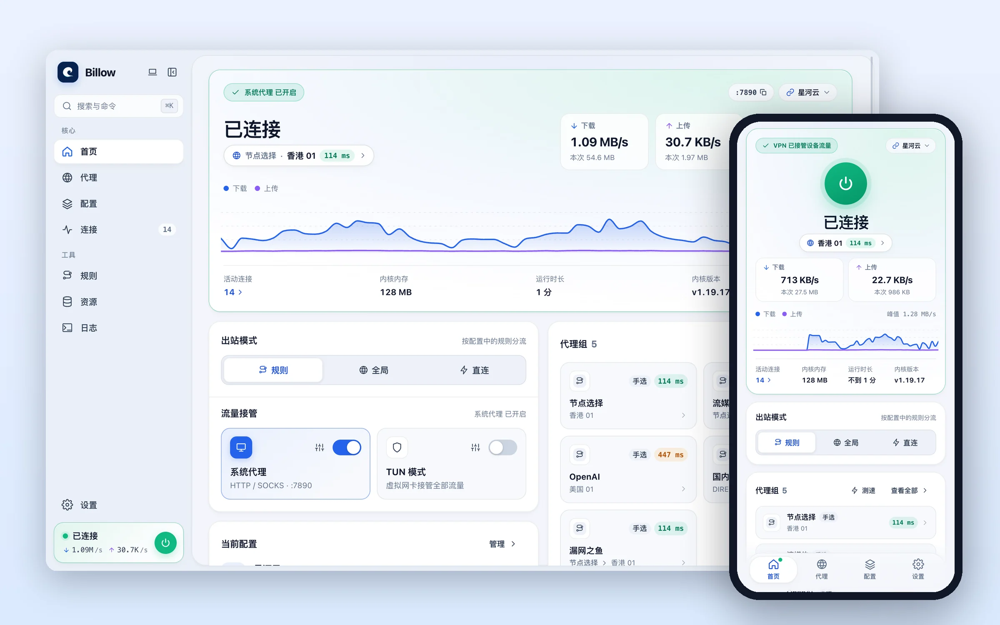
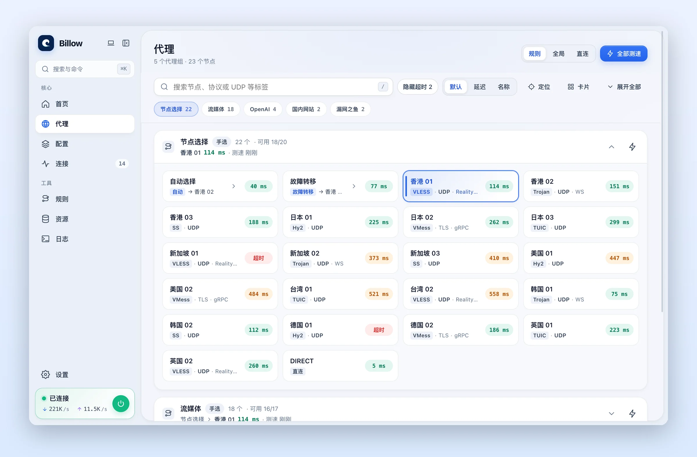
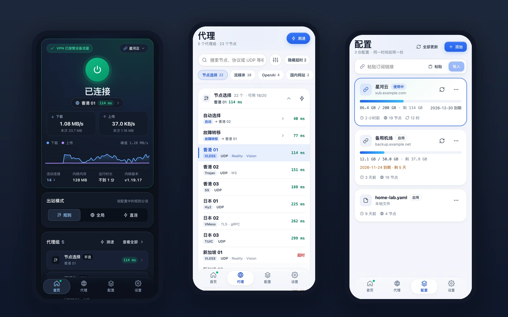

<div align="center">


# Billow

**一个顺手的 Mihomo 客户端，桌面和手机用同一套体验。**

粘贴订阅、点一下连接，就能用了。测速、换节点、看流量都在首页完成。

[](https://github.com/sakullla/Billow/releases/latest)
[](#下载安装)
[](https://github.com/sakullla/Billow/releases)
[](LICENSE)



</div>

## 为什么选 Billow

- **打开就能用**：安装包已内置 Mihomo 内核和 GEO 数据，不用另外下载。添加订阅后点一下电源键就能连接。
- **常用操作都在首页**：连接状态、实时网速、出站模式（规则 / 全局 / 直连）、代理组切换和一键测速都在首页。
- **订阅状态清楚**：每个订阅都显示已用流量、剩余天数和更新时间，快到期会变色提醒；更新失败的订阅可以一键重试。
- **手机上也好用**：Android 版按手机重新设计，不是缩小的桌面版：底部导航、底部弹出的选择面板，返回手势也能用。支持分应用代理。
- **轻量**：基于 Tauri，安装包小、内存占用低，不随应用打包一个浏览器。

## 功能一览



| | |
|---|---|
| 🌐 **代理与节点** | 按组测速，延迟用颜色区分；可以隐藏超时节点；卡片、紧凑、列表三种视图；链式代理会显示中转路径 |
| 📦 **配置管理** | 支持订阅链接、本地 YAML（拖进窗口就能导入）和 `billow://` 一键导入；可定时自动更新，可自定义 User-Agent，支持 age 加密订阅 |
| ✏️ **覆写** | 不改原订阅也能追加规则、修改字段；兼容 Clash Party 的 `+rules` / `key!` 语法和 JavaScript 脚本，保存前可以预览 |
| 🔌 **流量接管** | 桌面端支持系统代理（含 PAC 和绕过列表）、TUN 模式和局域网共享；Android 使用 VPN，并可按应用选择走不走代理 |
| 📊 **连接与日志** | 实时查看每条连接走的规则和节点；可以暂停列表、查看已关闭的连接，或从某条连接直接生成分流规则 |
| 🧭 **规则与资源** | 规则可以搜索，也能看命中次数；代理集和规则集可以批量更新，MRS 规则集可以直接打开查看；GEO 数据库可一键更新 |
| ⚙️ **进阶设置** | DNS / Hosts 覆写、内核版本切换与更新、开机自启、静默启动、关闭后留在托盘 |
| ⌨️ **效率** | `⌘K` / `Ctrl+K` 命令面板，可以跳转页面、切换节点或配置；页面也有快捷键；支持浅色和深色主题 |

### 手机端



## 下载安装

到 [Releases](https://github.com/sakullla/Billow/releases/latest) 下载对应平台的安装包：

| 平台 | 安装包 |
|---|---|
| Windows 10 / 11（x64） | `Billow_x.y.z_x64-setup.exe` |
| macOS（Apple Silicon） | `Billow_x.y.z_aarch64.dmg` |
| Linux（x64） | `.AppImage` 或 `.deb` |
| Android 7.0+（arm64） | `Billow_x.y.z_arm64.apk` |

桌面版会自动检查更新，在设置页就能升级。

> **macOS 提示“已损坏，无法打开”？** 应用还没有经过 Apple 公证。把 Billow 拖进「应用程序」后，在终端执行一次：
> ```bash
> xattr -dr com.apple.quarantine /Applications/Billow.app
> ```

## 三步上手

1. **添加配置**：在「配置」页粘贴订阅链接，或把 Clash / Mihomo 的 YAML 文件拖进窗口。
2. **连接**：回到首页，点中间的电源按钮。桌面端默认使用系统代理，需要全局接管时在首页打开 TUN 模式。
3. **选节点**：点首页的节点名称，或进入「代理」页，测速后选一个延迟低的节点。

<details>
<summary><b>机场如何提供一键导入链接</b></summary>

订阅地址经过 URL 编码后，拼成下面的链接：

```
billow://install-config?url=<URL 编码后的订阅地址>
```

用户点击链接后，Billow 会先弹窗确认，确认后才会添加。

</details>

## 常见问题

<details>
<summary><b>TUN 模式需要什么权限？</b></summary>

- **Windows**：只有内核进程以管理员权限运行（会弹出一次 UAC 确认），Billow 界面本身不需要提权。
- **macOS**：首次开启时输入一次管理员密码，之后不再询问。
- **Linux**：内核需要 root 权限或 `CAP_NET_ADMIN`，例如执行 `sudo setcap cap_net_admin,cap_net_bind_service=+ep <内核路径>`。

</details>

<details>
<summary><b>切换节点后，正在进行的下载会断吗？</b></summary>

默认会断开经过该代理组的旧连接，让应用马上改用新节点。不想中断下载或通话的话，可以在「设置 › 切换节点后重连」关掉，之后只有新建的连接会走新节点。

</details>

<details>
<summary><b>覆写会改动我的订阅吗？</b></summary>

不会。覆写单独保存，每次启用或更新订阅时才叠加上去。原订阅内容不变，随时可以关掉覆写。

</details>

## 从源码构建

需要 Node.js、Rust 1.90+，以及对应平台的 [Tauri 依赖](https://v2.tauri.app/start/prerequisites/)。

```bash
npm install
npm run dev            # 在浏览器预览界面（使用内置演示数据）
npm run tauri -- dev   # 运行原生应用
npm test               # 前端测试
npm run build:macos    # 打包；也可用 build:windows / build:linux / build:android
```

浏览器预览时，可以在地址后加 `?demo=android` 查看手机布局，加 `?demo=empty` 查看首次使用（没有配置）时的状态。

## 致谢

- [MetaCubeX/mihomo](https://github.com/MetaCubeX/mihomo)：代理内核
- [Tauri](https://tauri.app) 和 [Vue](https://vuejs.org)：应用框架

## 许可证

[GPL-3.0](LICENSE)
